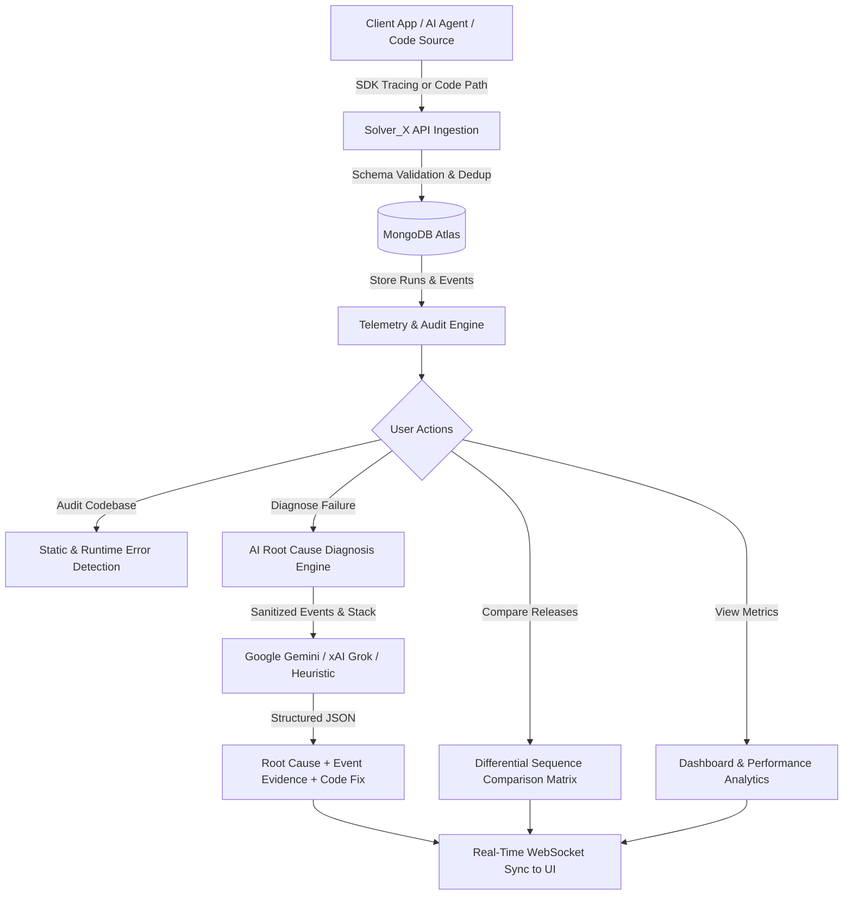

# Solver_X — Intelligent Application Observability & AI Run Failure Diagnosis

[]()
[]()
[]()
[]()

> **Solver_X** is an enterprise-grade developer platform that accelerates debugging and root-cause analysis for modern distributed applications and AI agent pipelines. It records granular execution events in MongoDB, compares baseline vs failing runs with differential trace matrices, and leverages LLMs (Google Gemini / xAI Grok) to generate evidence-backed failure diagnoses and automated remediations.

---

## Table of Contents

1. [Project Overview](#1-project-overview)
2. [Complete End-to-End Workflow](#2-complete-end-to-end-workflow)
3. [Key Technologies](#3-key-technologies)
4. [System Architecture](#4-system-architecture)
5. [Platform Modules & Capabilities](#5-platform-modules--capabilities)
6. [Getting Started & Setup Guide](#6-getting-started--setup-guide)
7. [Developer SDK Integration](#7-developer-sdk-integration)
8. [Automated Codebase Auditing](#8-automated-codebase-auditing)
9. [Pre-built Demo Scenarios](#9-pre-built-demo-scenarios)
10. [REST API Reference](#10-rest-api-reference)
11. [Troubleshooting & FAQ](#11-troubleshooting--faq)

---

## 1. Project Overview

### The Problem
Modern distributed systems, asynchronous microservices, and autonomous AI agents fail in complex ways:
- **Scattered Logs**: Diagnosing issues requires stitching together log files, HTTP traces, and database telemetry across multiple systems.
- **Silent Degradations**: Synchronous I/O blocks, null dereferences, and uncaught promise rejections cause silent stalls or high tail latency before crashing.
- **Lack of Baseline Divergence**: Developers rarely have an immediate side-by-side comparison between the last successful execution run and the current broken run.
- **Hallucinated Diagnostics**: Generic AI chat interfaces lack direct access to raw execution event traces and error stack frames, resulting in inaccurate suggestions.

### The Solution: Solver_X
Solver_X eliminates manual log digging by providing an end-to-end observability pipeline:
1. **Telemetry Ingestion**: Micro-SDKs and REST APIs record every step of execution into MongoDB Atlas with guaranteed duplicate-event deduplication.
2. **Static & Runtime Code Auditing**: Directly scans local folders or uploaded repositories to detect defects, security vulnerabilities, and blocking operations.
3. **Differential Trace Matrix**: Compares any baseline run against a target run side-by-side to highlight the exact step where timing, status, or payloads diverged.
4. **Evidence-Based AI Diagnosis**: Passes sanitized event traces to Google Gemini or xAI Grok to output structured root-cause explanations tied to specific event IDs and code line numbers.
5. **Real-Time Live Dashboard**: Updates metrics, graphs, bug issue trackers, and release history instantly using Socket.IO WebSockets.

---

## 2. Complete End-to-End Workflow



### Step-by-Step Workflow Breakdown

1. **Project Registration**:
   - Register a software service or AI agent with an ID, name, and source reference (telemetry, local path, or uploaded code files).

2. **Run Lifecycle Tracking**:
   - An execution run is initiated via `devtrace.startRun({ projectId, name })`.
   - Each operation (database query, third-party API call, auth check, file read) emits an event via `devtrace.track()`.
   - The run completes with `devtrace.endRun(runId, 'success' | 'failed')`.

3. **Validation & Deduplication**:
   - The Express backend enforces required fields (`eventId`, `runId`, `projectId`, `type`, `status`).
   - MongoDB unique compound indexes prevent duplicate events from polluting telemetry.

4. **Codebase Static & Runtime Audit**:
   - When a project folder or file path is submitted, the backend recursively inspects user code files.
   - Detects hardcoded credentials, blocking synchronous I/O, unsafe null dereferences, and empty catch blocks.
   - Automatically registers a unique audit run (`audit-<projectId>-<timestamp>`) marked as `success` (clean) or `failed` (defects detected).

5. **Differential Trace Comparison (`/compare`)**:
   - Select any baseline run (Run 1) and target run (Run 2).
   - Solver_X computes duration differences, event delta, and step-by-step sequence matching to isolate divergences.
   - Selections remain stable across project changes, with full execution history displayed below.

6. **AI Root Cause Diagnosis (`/diagnosis`)**:
   - Evaluates the failing run's sequence and error stack traces using Google Gemini, xAI Grok, or the built-in offline heuristic engine.
   - Outputs:
     - **Summary**: Plain-English executive briefing.
     - **Root Cause**: The verified culprit causing the failure.
     - **Evidence**: Event IDs and exact observations supporting the finding.
     - **Suggested Fixes**: Concrete code patches and operational steps.

7. **Real-Time Visualization**:
   - WebSockets broadcast `new_event`, `run_created`, `run_updated`, and `code_analyzed` to keep all open browser sessions in sync.

---

## 3. Key Technologies

| Layer | Technology | Version | Purpose |
|---|---|---|---|
| **Frontend UI** | React | 19.x | Component-based modern UI architecture |
| **Build Tool** | Vite | 6.x | Fast development server and optimized bundle generation |
| **Styling** | Tailwind CSS | 3.4.x | Dark-mode design system and layout styling |
| **Icons** | Lucide React | Latest | Consistent vector iconography |
| **Charts** | Recharts | 3.x | Latency trends, timeline distributions, and health gauges |
| **Backend Server** | Node.js + Express | 20.x / 4.21.x | REST API server, validation middleware, and telemetry intake |
| **Database** | MongoDB Atlas | 7.x / 8.x | Document storage for Projects, Runs, and Events |
| **ODM** | Mongoose | 8.9.x | Schema validation, unique indexing, and aggregation pipelines |
| **Realtime** | Socket.IO | 4.8.x | Bi-directional WebSocket communication for live telemetry |
| **AI LLM Engine** | Google Gemini API | `@google/generative-ai` | Primary failure diagnostics and codebase auditing |
| **Alternative AI** | xAI Grok API | OpenAI-compatible REST | Ultra-low latency deep diagnostic reasoning |
| **Fallback AI** | Heuristic Static Engine | Native JS AST/Regex | 100% offline analysis ensuring zero downtime |
| **Client SDK** | DevTrace SDK | 1.0.0 | Lightweight Node.js client library for application instrumentation |

---

## 4. System Architecture

```text
┌─────────────────────────────────────────────────────────────┐
│                    Developer Applications                   │
│   (Express Apps, Microservices, Python Scripts, AI Agents)   │
└──────────────────────────────┬──────────────────────────────┘
                               │
                SDK Telemetry & REST Requests
                               │
                               ▼
┌─────────────────────────────────────────────────────────────┐
│                   Solver_X Express Backend                  │
│                                                             │
│  ┌───────────────────────┐     ┌─────────────────────────┐  │
│  │ Ingestion Controller  │     │   Code Audit Engine     │  │
│  │ - Validation Guards   │     │   - Multi-path Scanner  │  │
│  │ - Deduplication Check │     │   - Static AST Analyzer │  │
│  └───────────┬───────────┘     └────────────┬────────────┘  │
│              │                              │               │
│              ▼                              ▼               │
│  ┌───────────────────────────────────────────────────────┐  │
│  │           Mongoose Schema & Indexing Layer            │  │
│  │          Projects  |  Runs  |  Events Collection      │  │
│  └───────────────────────────┬───────────────────────────┘  │
│                              │                              │
│              ┌───────────────┴───────────────┐              │
│              ▼                               ▼              │
│  ┌───────────────────────┐     ┌─────────────────────────┐  │
│  │ Comparison Service    │     │ AI Diagnosis Service    │  │
│  │ - Trace Diff Engine   │     │ - Data Sanitizer        │  │
│  │ - Failure Divergence  │     │ - Gemini & Grok Client  │  │
│  └───────────────────────┘     │ - Heuristic Fallback    │  │
│                                └─────────────────────────┘  │
└──────────────────────────────┬──────────────────────────────┘
                               │
                      WebSocket & REST API
                               │
                               ▼
┌─────────────────────────────────────────────────────────────┐
│                     Solver_X Dashboard                      │
│   Dashboard  |  Issues  |  Performance  |  Discover         │
│   Releases & Compare  |  AI Diagnosis  |  Projects & Code   │
└─────────────────────────────────────────────────────────────┘
```

---

## 5. Platform Modules & Capabilities

### 📊 1. Dashboard (`/`)
- High-level telemetry metrics: total execution runs, failure rates, total events collected, and overall system health score.
- Active project status cards and live execution activity feed.
- Status distribution chart (Successful vs. Failed runs).

### ⚠️ 2. Issues & Bug Tracker (`/issues`)
- Categorized defect tracking: Security Vulnerabilities, Runtime Errors, Null Pointer Risks, and Blocking I/O.
- Culprit breakdown with exact file name, line number, severity level (`critical`, `high`, `medium`, `low`), and suggested fix.
- Interactive status filter (Open, In Progress, Resolved).

### ⚡ 3. Performance & Bottlenecks (`/performance`)
- Real-time anchored latency timeline graphs displaying milliseconds latency across actual timestamps.
- **P50 Latency (Median)**, **P95 Latency (Tail)**, and **Average Latency** metrics calculated from execution events.
- Dedicated **Bug Issues Section** located directly beneath stats for consolidated triaging.

### 🔍 4. Discover Telemetry Explorer (`/discover`)
- Low-level telemetry search and exploration across all recorded events.
- Filter by Event Type, Status (`success`, `failed`, `info`, `warning`), Project, or Run ID.
- Expandable JSON payload viewer with syntax formatting.

### 🚀 5. Releases & Run Comparison (`/compare`)
- **Differential Trace Comparison**: Compare Baseline (Run 1) vs Target (Run 2).
- **Sequence Comparison Matrix**: Step-by-step table highlighting where event types, statuses, or durations diverged.
- **Stable Project Selection**: Switching projects in the navbar preserves your selected Baseline and Target runs.
- **Execution & Audit History Table**: Chronological table of all trace and audit runs with status badges (`SUCCESS` / `FAILED`), duration, and quick-action buttons:
  - `Set Baseline`
  - `Set Target`
  - `Diagnose with AI`

### 🧠 6. AI Root Cause Diagnosis (`/diagnosis`)
- Deep root-cause diagnostic reports generated by Google Gemini or xAI Grok.
- Isolates the exact culprit step, supporting event evidence IDs, confidence score, and verified suggested checks.
- Deep-links directly from Releases or Projects (`/diagnosis?runId=...`).
- Built-in heuristic fallback engine guarantees debugging never fails even if external LLM APIs are offline.

### 📁 7. Projects & Codebase Diagnosis (`/projects`)
- Register and configure telemetry projects, local directories, or file uploads.
- **Analyze Code with AI**: Recursively scans local paths (e.g. `test-code/project-with-errors/index.js`) or uploaded files.
- Automatically generates real execution `Run` and `Event` documents in MongoDB so code audits are fully auditable, comparable, and diagnosable across the entire platform.

### ❓ 8. Help Station (`/help`)
- Interactive platform user guide detailing each module and best practices.
- Copy-paste ready SDK instrumentation snippets for Node.js and Express.
- Architecture reference and error scenario cheat sheet.

---

## 6. Getting Started & Setup Guide

### Prerequisites
- **Node.js**: v18.0.0 or higher (`node -v`)
- **npm**: v9.0.0 or higher (`npm -v`)
- **MongoDB**: MongoDB Atlas connection URI or local MongoDB instance running at `mongodb://localhost:27017`
- *(Optional)* **Google Gemini API Key** or **xAI Grok API Key** for LLM diagnosis

### 1. Clone the Repository
```bash
git clone https://github.com/your-username/Solver_X.git
cd Solver_X
```

### 2. Install All Dependencies
Install root, backend, frontend, sdk, and sample app dependencies in one command:
```bash
npm run install:all
```

Alternatively, install each package individually:
```bash
npm install
cd backend && npm install && cd ..
cd frontend && npm install && cd ..
cd sdk && npm install && cd ..
cd sample-app && npm install && cd ..
```

### 3. Configure Environment Variables
Copy `.env.example` into `backend/.env`:
```bash
cp .env.example backend/.env
```

Edit `backend/.env` with your preferred settings:
```env
# Backend Server
PORT=5001
NODE_ENV=development

# MongoDB Connection String
MONGODB_URI=mongodb://localhost:27017/devtrace
# For MongoDB Atlas:
# MONGODB_URI=mongodb+srv://<username>:<password>@cluster0.abcde.mongodb.net/devtrace?retryWrites=true&w=majority

# AI Provider Configuration (Google Gemini or xAI Grok)
GEMINI_API_KEY=your_gemini_api_key_here
GEMINI_MODEL=gemini-1.5-flash

# (Alternative) xAI Grok API Key:
# GROK_API_KEY=your_xai_grok_key_here
# GROK_MODEL=grok-2-latest

# Client URL (for CORS)
CLIENT_URL=http://localhost:5173
```

Frontend environment configuration (`frontend/.env`):
```env
VITE_API_BASE_URL=http://localhost:5001/api
VITE_SOCKET_URL=http://localhost:5001
```

### 4. Run Development Servers
Start both backend and frontend concurrently:
```bash
npm run dev
```

- **Backend API**: `http://localhost:5001/api`
- **Frontend Dashboard**: `http://localhost:5173`
- **Health Check**: `http://localhost:5001/api/health`

---

## 7. Developer SDK Integration

The official SDK (`sdk/`) enables seamless telemetry instrumentation in your application with minimal code.

### Installation
Link the local package or install from npm:
```bash
npm install devtrace-sdk
```

### Basic Instrumentation Example
```javascript
const devtrace = require("devtrace-sdk");

async function executeOrderWorkflow(orderData) {
  // 1. Start execution lifecycle
  const run = await devtrace.startRun({
    projectId: "ecommerce-backend",
    name: "checkout-order-pipeline",
  });

  try {
    // 2. Track successful database operation
    await devtrace.track({
      runId: run.runId,
      type: "database_query",
      status: "success",
      durationMs: 42,
      payload: {
        collection: "orders",
        action: "insert",
        orderId: orderData.id,
      },
    });

    // 3. Track external payment gateway call
    await devtrace.track({
      runId: run.runId,
      type: "external_api_call",
      status: "success",
      durationMs: 180,
      payload: {
        endpoint: "https://api.stripe.com/v1/charges",
        amount: orderData.total,
      },
    });

    // 4. Mark run completed successfully
    await devtrace.endRun(run.runId, "success");
    return { success: true };
  } catch (error) {
    // 5. Track failure event with error message and stack trace
    await devtrace.track({
      runId: run.runId,
      type: "payment_processing_error",
      status: "failed",
      durationMs: 15,
      payload: {
        errorName: error.name,
        message: error.message,
        stack: error.stack,
      },
    });

    // 6. Mark run failed
    await devtrace.endRun(run.runId, "failed");
    throw error;
  }
}
```

---

## 8. Automated Codebase Auditing

Solver_X includes a static analysis and vulnerability auditor capable of scanning real codebases.

### Testing Pre-built Code Samples
Two test projects are provided in `test-code/`:
- `test-code/project-with-errors/index.js`: Contains 4 real-world defects (hardcoded API key, blocking `readFileSync`, null pointer dereference, empty catch block).
- `test-code/project-clean/index.js`: Clean asynchronous implementation adhering to security and performance best practices.

### Running an Audit via the Dashboard
1. Navigate to **Projects** (`/projects`).
2. Click **Create Project**.
3. Select **Source Type: Local Path** and input `test-code/project-with-errors`.
4. Click **Create & Audit Codebase with AI**.
5. Solver_X parses the code, identifies all 4 defects, records an audit `Run` document with `status: failed`, and emits error events to the **Issues** and **Releases** pages.
6. Open **Releases** (`/compare`) to compare the audit run with `project-clean` or view the **AI Diagnosis** (`/diagnosis`).

---

## 9. Pre-built Demo Scenarios

Run interactive demo scenarios to verify the entire platform lifecycle:

```bash
# Run all demo scenarios in sequence:
npm run demo
# or
node sample-app/run-all.js
```

### Individual Scenarios
| Scenario | Script | Description |
|---|---|---|
| **Scenario A: Success** | `node sample-app/success.js` | Runs a multi-step user search pipeline with clean database and cache queries. Stored as `success`. |
| **Scenario B: Failure** | `node sample-app/failure.js` | Simulates a database timeout and unhandled exception. Stored as `failed` with stack trace. Ready for instant AI diagnosis. |
| **Scenario C: Deduplication** | `node sample-app/duplicate-event.js` | Emits identical events with the same `eventId`. Verifies MongoDB rejects duplicates with HTTP 409 while preserving data integrity. |

---

## 10. REST API Reference

All endpoints return standard JSON responses conforming to `{ success: boolean, data?: any, error?: { code, message } }`.

### Projects API
| Method | Endpoint | Description |
|---|---|---|
| `POST` | `/api/projects` | Create a new project and optionally trigger auto-analysis |
| `GET` | `/api/projects` | List all registered projects |
| `GET` | `/api/projects/:projectId` | Retrieve project details and cached code analysis |
| `DELETE` | `/api/projects/:projectId` | Delete project and associated runs and events |
| `POST` | `/api/projects/:projectId/analyze` | Trigger on-demand codebase static audit with AI |

### Runs API
| Method | Endpoint | Description |
|---|---|---|
| `POST` | `/api/runs` | Initialize a new execution run (`status: running`) |
| `PATCH` | `/api/runs/:runId` | Complete an execution run (`status: success | failed`) |
| `GET` | `/api/runs` | Query runs with optional `projectId`, `status`, and `limit` |
| `GET` | `/api/runs/:runId` | Get detailed run document including diagnosis |
| `GET` | `/api/runs/:runId/events` | Retrieve chronological timeline events for a run |

### Events API
| Method | Endpoint | Description |
|---|---|---|
| `POST` | `/api/events` | Ingest single execution event (deduped by `eventId`) |
| `POST` | `/api/events/batch` | Batch ingest up to 100 events in a single transaction |
| `GET` | `/api/events` | Discover query events by type, status, or project |

### Comparison & Diagnosis API
| Method | Endpoint | Description |
|---|---|---|
| `GET` | `/api/compare/:runId1/:runId2` | Compute differential comparison matrix between two runs |
| `GET` | `/api/diagnosis/:runId` | Generate AI root-cause diagnosis for a specific run |
| `GET` | `/api/analytics/overview` | Retrieve system telemetry KPIs and latency metrics |

---

## 11. Troubleshooting & FAQ

#### Q: The AI diagnosis returns "AI diagnosis failed to complete"?
> **Solution**: Check that `GEMINI_API_KEY` or `GROK_API_KEY` in `backend/.env` is valid and has quota. If no API key is supplied, Solver_X automatically falls back to its internal heuristic engine so debugging is never interrupted.

#### Q: How does Solver_X prevent duplicate events?
> **Solution**: The MongoDB `Event` collection enforces a unique index on `eventId`. When a duplicate event is transmitted, the backend catches the E11000 index violation and safely returns HTTP 409 without terminating the application.

#### Q: Can I run Solver_X completely offline?
> **Solution**: Yes. If external internet access or LLM keys are unavailable, Solver_X automatically switches to its offline rule-based heuristic engine, which provides full line-by-line static analysis, error discovery, and trace comparisons.

---

## License

This project is licensed under the MIT License — see the [LICENSE](LICENSE) file for details. Built with ❤️ by the **Solver_X** Team.
